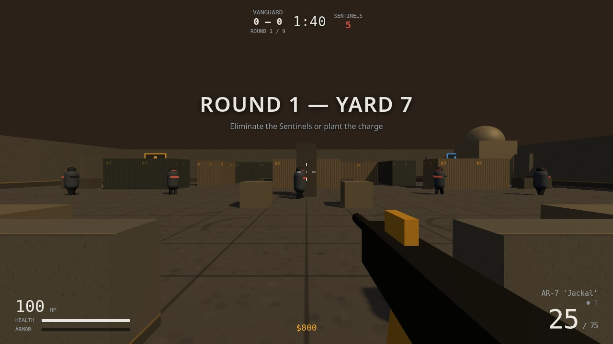

# DUSTLINE — a three.js tactical FPS



A round-based tactical first-person shooter in the style Counter-Strike made
famous — your own map, art, sounds and names. Built for make.fun bounty
**threejs-fps-02** ("Make the best three.js tactical FPS").

## The game

You are the **Vanguard**, a solo attacker, against five **Sentinel** bots
defending **YARD 7** — a 52 x 36 m desert-industrial yard with two bomb
sites (A DEPOT west, B SILO east) and three lanes (A-long, mid, B-long).
First to 5 round wins takes the match (max 9 rounds).

- **Rounds**: freeze 12 s (buy menu, `B`) → live 100 s → planted 40 s.
  Win by eliminating all Sentinels, by detonating the charge, or by holding
  the site. Lose by dying, by defuse, or by the clock.
- **Economy**: start $800, kill +$300, plant +$300, win +$3250, loss +$1900.
- **Weapons**: AR-7 'Jackal' rifle ($2700), SMG-9 'Wasp' ($1500),
  P9 'Sidearm' pistol (free), FRAG-12 grenade ($200), Vest + Helmet ($650).
- **Gunplay**: hitscan with headshots (2x), recoil springs, spread bloom
  that punishes firing on the move, ADS, reloads, finite ammo.
- **Bots**: a 5-state AI (patrol / chase / attack / search / flee) plus a
  defuse state — they follow routes, hold positions, strafe, burst-fire,
  and react to what they see and hear. Difficulty ramps with rounds won.
- **Tech**: three.js 0.187.0 vendored, fixed 60 Hz sim, seeded RNG
  (mulberry32, seed 7 — same seed replays the same round), pooled VFX,
  procedural canvas textures, WebAudio synth sounds. No network, no build
  step — static files only.

## Play

```sh
node serve.ts
# open http://localhost:8080
```

| Key | Action |
| --- | --- |
| WASD / Shift / Ctrl / Space | Move / sprint / crouch / jump |
| Mouse | Look (click to lock) |
| Click / Right mouse | Fire / aim down sights |
| R | Reload |
| 1 / 2 / 3 | Rifle / SMG / pistol |
| G | Throw grenade |
| E (hold, inside a site) | Plant the charge |
| B | Buy menu (freeze time) |
| Esc | Pause |

## Layout

```
game/            playable game, static ES modules (three.js vendored)
  index.html     HUD, overlays, buy menu, import map
  src/
    config.js    every tunable (the dossier's balance table lives here)
    about.js     systems / balance / perf / limits, in the judge's terms
    world.js     YARD 7 map, merged geometry, AABBs, nav graph
    player.js    movement + shared circle-vs-AABB resolver
    weapons.js   3 guns + grenade, viewmodels, recoil springs
    enemies.js   Sentinel bot AI (5 states + defuse)
    rounds.js    round machine + economy + bomb (pure logic)
    fx.js        pooled tracers / sparks / decals / shells / explosions
    audio.js     WebAudio synth sounds
    hud.js       all DOM writes
    input.js     pointer lock + keys + firing watchdog
    materials.js procedural canvas textures
    rng.js       mulberry32 seeded RNG
    palette.js   six-colour desert-dusk palette
screenshots/     4 real in-browser renders (seed 7, scripted ?shot= frames)
main.ts          hands game/ + screenshots/ + dossier.json to /output
```

Deterministic captures: `?shot=start|play|tactics|economy&seed=7` renders a
scripted frame and sets `window.__shotReady`. `?selftest=1` plays a scripted
40 s combat and reports `window.__selftest` (kills, accuracy, HP, draw calls).

## License

MIT — see `LICENSE`. three.js (MIT) vendored byte-for-byte under
`game/vendor/three/`.
